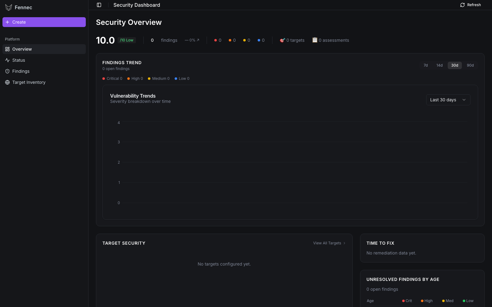

<p align="center">
  
</p>

# Fennec

**Open-source, AI-driven penetration testing. Point it at a target you control, and a fleet of agents will recon, hypothesize, exploit, and report — autonomously.**

[**🌐 Hosted version: fenneclabs.ai**](https://fenneclabs.ai) — managed runner, team features, persistent jobs. Join the waitlist there if you'd rather not self-host.

> **Authorized testing only.** Fennec is built to assist security testing against systems you own or have explicit written permission to assess. Don't point it at anything else.

---

<p align="center">
  
</p>

## Why Fennec

Most automated scanners are noise generators. They emit hundreds of "potential" CVE matches that a human has to spend a week triaging — most of which are false positives, version-banner mismatches, or unreachable code paths. Fennec is built differently:

- **Every finding is exploitable.** The pentester agent doesn't ship a result until it has reproducible evidence: a request, a payload, the observed response. If the agent couldn't actually trigger the vulnerability, it gets marked `safe` or `inconclusive`, not added to the findings list. There's no CVSS-based guessing.
- **Hypothesis-driven, not signature-driven.** Recon maps the attack surface. The analyst forms testable hypotheses ("the `/api/users/{id}` endpoint may be vulnerable to IDOR because the auth check looks shallow"). The pentester picks them one at a time and runs targeted tools — not a 1000-rule template sweep. Fewer dead-ends, deeper coverage.
- **It thinks like an attacker.** The coder sub-agent can write custom exploit payloads when an off-the-shelf tool doesn't fit (encoded JWTs, unusual content types, application-specific bypasses). Most scanners can't do this.
- **Minutes, not weeks.** A typical scan runs in 5–30 minutes per target depending on the assessment depth (`turbo` / `balanced` / `deep` presets). Findings appear in the dashboard as the agents confirm them.
- **You see exactly what it did.** Every tool invocation, every response, every reasoning step is captured. Open any finding to inspect the full chain. No black box.
- **Your data stays local.** No telemetry. No SaaS callback. The agent runs on your laptop, talks to your LLM provider, scans the targets you specify. Findings are stored in-process and exported as JSON / Markdown.

There is a [hosted version at fenneclabs.ai](https://fenneclabs.ai) with team features, persistent job history, and a managed runner. This open-source repo is the same agent core, stripped of the multi-tenant infrastructure — designed to run on one laptop with one API key.

## Requirements

- Docker Desktop (or Docker Engine ≥ 20.10)
- An LLM API key — one of **Anthropic** (recommended), **OpenAI**, or **OpenRouter**
- ~15 GB free disk for the Kali execution image (built once)
- Python 3.11+ only if you want to skip Docker for the agent itself and run the CLI directly

## Quickstart (one command, after a one-time build)

```bash
git clone git@github.com:NabilAziz99/Fennec.git
cd Fennec

# 1. Drop your API key into .env
cp .env.example .env
echo "ANTHROPIC_API_KEY=sk-ant-..." >> .env

# 2. Build the Kali execution image (one-time, ~5 min, ~14 GB)
cd linux && make build && cd ..

# 3. Bring up the stack
docker compose up --build
```

Open **http://localhost:3000** for the dashboard. Backend API is at **http://localhost:8000** (try `/health`).

> If you only want the CLI and not the dashboard, see [CLI mode](#cli-mode) below.

## Walkthrough — your first scan

Once the stack is up:

1. **Open the dashboard** at <http://localhost:3000>. You'll land on the Security Overview (the screenshot above) — empty at first.

2. **Add a target.** Click **Target Inventory** in the sidebar → **Add Target**. Enter a domain you own or have written permission to test (e.g. `http://localhost:9000` if you're testing a local app, or your own staging URL). The target gets a verification token; click **Verify** (in OSS mode this is auto-trust).

3. **Optional: add credentials.** If your target has a login wall and you want the agent to authenticate, click **Add Credential** on the target. The agent will use these during recon and exploitation. Plaintext stays only in the local Postgres / in-memory store; nothing is sent to the LLM unless the agent needs to construct an authenticated request.

4. **Start a scan.** Click **+ Create** in the sidebar, pick the target, choose a method:
   - **`turbo`** — short tool budgets, ~5 min, good for smoke-testing a target
   - **`balanced`** (default) — ~15–30 min, a normal pentest pass
   - **`deep`** — generous budgets, ~30–60 min, for thorough engagements

   Click **Start Pentest**.

5. **Watch the agents work.** The Status page streams live events: recon results, hypotheses being formed, tool calls (nmap, curl, sqlmap, custom payloads), and findings as they're confirmed. The hypothesis tree shows what's pending / in-progress / vulnerable / safe.

6. **Review findings.** Open **Findings** in the sidebar to see confirmed vulnerabilities grouped by severity. Click any finding to drill into the evidence: the exact request that triggered it, the response observed, the OWASP category, the suggested fix, and the full reasoning trail.

7. **Export.** Each finding has a JSON export. The agents also dump a Markdown report under `./reports/<timestamp>_<host>/summary.md` for the CLI flow.

## CLI mode

If you don't want the dashboard, the CLI gives you the same agent loop with a single command:

```bash
pip install -r requirements.txt
python cli.py scan --target https://your-target.example --output ./reports
```

Reports land under `./reports/<timestamp>_<host>/` with `summary.md`, per-agent activity logs, and a `findings/` directory of confirmed vulnerabilities.

For benchmarking or programmatic use:

```python
import asyncio
from agent import run_pentest, PentestTask, PentestMode

async def main():
    task = PentestTask(
        target_url="http://localhost:8000",
        description="Find authentication and injection vulnerabilities",
        mode=PentestMode.BLACK_BOX,
        tags=["sqli", "auth"],
    )
    result = await run_pentest(task)
    print(f"Success: {result.success}")
    for v in result.vulnerabilities:
        print(f"  - {v}")

asyncio.run(main())
```

## Configuration

Everything is `.env`-driven. The knobs that matter:

| Variable | What it does |
|---|---|
| `LLM_PROVIDER` | `anthropic` (default), `openai`, or `openrouter` |
| `LLM_MODEL` | Model name for the provider (default `claude-sonnet-4-20250514`) |
| `ANTHROPIC_API_KEY` / `OPENAI_API_KEY` / `OPENROUTER_API_KEY` | One must be set, matching `LLM_PROVIDER` |
| `DOCKER_IMAGE` | Kali image tag (default `fennec-linux`, built by `linux/Makefile`) |
| `EXECUTION_MODE` | `docker` (default — spawn a Kali sibling per scan) or `local` (run tools in the agent container directly) |
| `FENNEC_METHOD` | `turbo` / `balanced` / `deep` |
| `HTLI` | `true` to pause for operator approval between hypotheses |
| `RECON_MIN_MODEL_CALLS`, `ANALYST_MODEL_CALL_LIMIT`, `PENTESTER_MODEL_CALL_LIMIT` | Per-agent call-budget caps (cost control) |
| `TAVILY_API_KEY`, `PERPLEXITY_API_KEY` | Optional — enables enhanced web search during recon |

## How it works

```
┌─────────────┐     ┌──────────────┐     ┌──────────────┐
│   Recon     │ ──> │   Analyst    │ ──> │ Orchestrator │
│ (scan tools)│     │ (hypotheses) │     │  (routing)   │
└─────────────┘     └──────────────┘     └──────┬───────┘
                                                │
                                                ▼
                                         ┌──────────────┐
                                         │  Pentester   │
                                         │  (testing)   │
                                         └──────────────┘
                                                │
                            ┌───────────────────┘
                            ▼
                     ┌─────────────┐
                     │    Coder    │   invoked by pentester when
                     │ (exploits)  │   custom payload is needed
                     └─────────────┘
```

- **Recon** maps the attack surface — endpoints, technologies, auth flows. Built on nmap, curl, gobuster, nuclei, subfinder, httpx, and a browser tool.
- **Analyst** reads recon data and emits a prioritised queue of testable hypotheses tagged with required skills and OWASP category.
- **Pentester** picks one hypothesis at a time, runs targeted tool calls, and emits a `PentesterResult` (status, verdict, evidence, suggested remediation). Won't fabricate findings — if it can't trigger the vulnerability, the verdict is `safe` or `inconclusive`.
- **Coder** writes custom exploit code (Python or shell) when the pentester needs something off-the-shelf tools can't do.
- **Orchestrator** is **not** an LLM. It's pure routing logic: process the last pentester result, update the hypothesis tree, decide what's next.

See [docs/ARCHITECTURE.md](docs/ARCHITECTURE.md) for the deeper breakdown — state schema, LangGraph wiring, middleware chain, method presets.

## Differences from the hosted version

| | OSS (this repo) | [fenneclabs.ai](https://fenneclabs.ai) |
|---|---|---|
| Auth | None — single user | Team accounts, OAuth |
| Job persistence | JSON reports / in-memory | Postgres, full history |
| Queue | One scan at a time | Managed multi-tenant queue |
| Dashboard | Local | Hosted with sharing |
| LLM keys | Yours, in `.env` | Managed |
| Updates | `git pull` | Continuous |

The agent code itself is identical. Only the surrounding infrastructure differs.

## Project layout

```
.
├── agent.py                # Programmatic API: run_pentest(task) → AgentResult
├── cli.py / cli/main.py    # CLI entrypoint
├── src/
│   ├── api/                # FastAPI server (server.py, job_store.py, events.py)
│   ├── agents/             # recon, analyst, pentester, coder, human_review
│   ├── graph/              # LangGraph wiring + orchestrator routing
│   ├── tools/              # terminal, browser, file_read/write, web_search
│   ├── docker/             # aiodocker wrapper that spawns the Kali container
│   ├── prompts/            # Per-agent system prompts + section composition
│   ├── schemas/            # Pydantic models for tool I/O
│   ├── state/              # FennecState TypedDict + hypothesis/finding types
│   ├── middleware/         # LangChain middleware (budget, truncation, retries)
│   └── orchestration/      # HypothesisManager
├── linux/                  # Kali Dockerfile + wordlists (`make build`)
├── frontend/               # React + Vite dashboard (Apache-licensed)
└── docker-compose.yml
```

## Contributing

Issues and PRs welcome. Before submitting:

- `python -m py_compile src/**/*.py` should pass
- New tools belong in `src/tools/` with a Pydantic input schema
- New agents need an entry in `AgentType`, a router branch in `src/graph/`, and a prompt in `src/prompts/`
- Don't add proprietary services, telemetry, or auth gates — OSS stays vendor-neutral

## License

[Apache License 2.0](LICENSE).

## Acknowledgements

Built on [LangGraph](https://github.com/langchain-ai/langgraph), [LangChain](https://github.com/langchain-ai/langchain), and the [Kali Linux](https://www.kali.org/) tools ecosystem.
